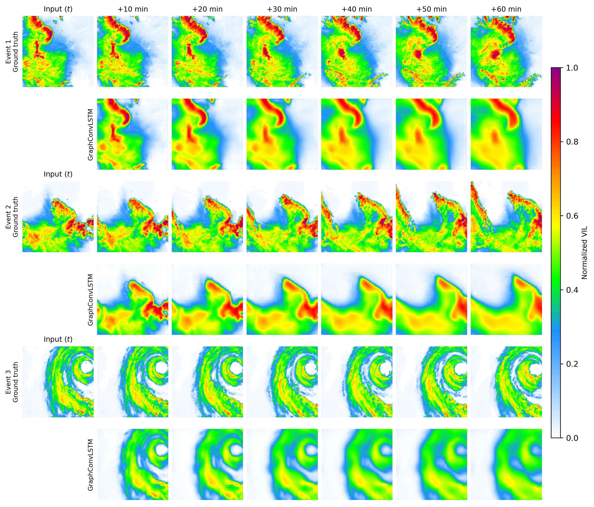
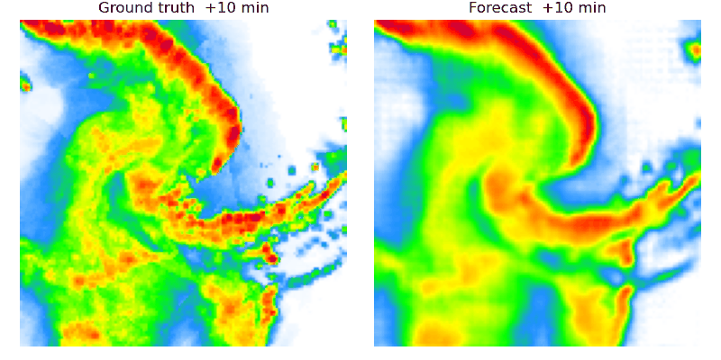
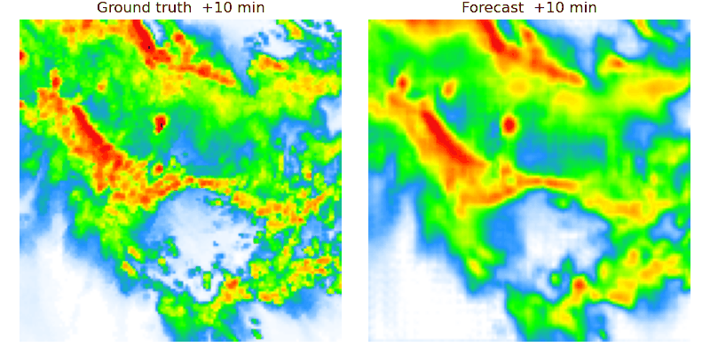

# GraphConvLSTM for SEVIR nowcasting

Code for GraphConvLSTM, our recurrent model for radar precipitation nowcasting. It replaces
the convolution in the ConvLSTM gates with multi-head graph attention, and recomputes the
edge weights at every step from a Gaussian similarity between node features. Trained on SEVIR
VIL frames, 7 frames in and 6 out, at 128x128.

The repo has four folders:

- `models/` : the data pipeline and the training scripts (main model and the ablations).
- `analysis/` : metric aggregation, the significance test, and the post-hoc spectral/FSS checks.
- `results/` : a couple of example per-seed metric files (see below).
- `figures/` : the sample forecasts and the animations shown at the bottom.

`models/` and `analysis/` each have a short README.

SEVIR data is not included (it is large and has its own terms). We pulled the VIL files from
the public SEVIR S3 bucket with the AWS CLI, no account needed:

    aws s3 sync s3://sevir/data/vil/2019 <dest> --include "SEVIR_VIL_*_2019_*.h5" --no-sign-request
    aws s3 cp   s3://sevir/CATALOG.csv   <dest> --no-sign-request

We used the 2017 to 2019 VIL STORMEVENTS and RANDOMEVENTS files. After downloading, point the
paths in `models/05_sevir_dataset.py` at wherever you saved them. SEVIR is from Veillette et
al. (2020); see the AWS Open Data registry entry for SEVIR for the full dataset.

Rough order to run things:

    pip install -r requirements.txt
    python models/05_sevir_dataset.py            # HDF5 -> .npy tensors
    SEED=42 python models/15a_graphconvlstm_gat_truba.py
    python analysis/aggregate_ablation.py

The paths in the scripts were set for the high-performance computing cluster and Kaggle
environment we ran on, so change them for your own machine. Training used mixed precision on
a single V100 or T4 GPU.

The `results/` folder holds a couple of example metric files (the main model and the
convolution baseline at one seed) so you can see the output format and the operator
comparison at a glance. The full per-seed numbers and the tables are in the paper.

A manuscript describing the work is in preparation. Code is under the MIT license.

## Example forecasts

Three test storms (a hook-shaped cell, a squall line, and a rotating system), ground truth
on top and the model forecast below, from +10 to +60 min. These are extra examples, not the
ones shown in the paper.

Two more test sequences as animations, ground truth against the model forecast over the
hour:

## Citation

The paper for this work is in preparation. Once it is published, the citation and a BibTeX
entry will be added here. Until then, please link to this repository.
